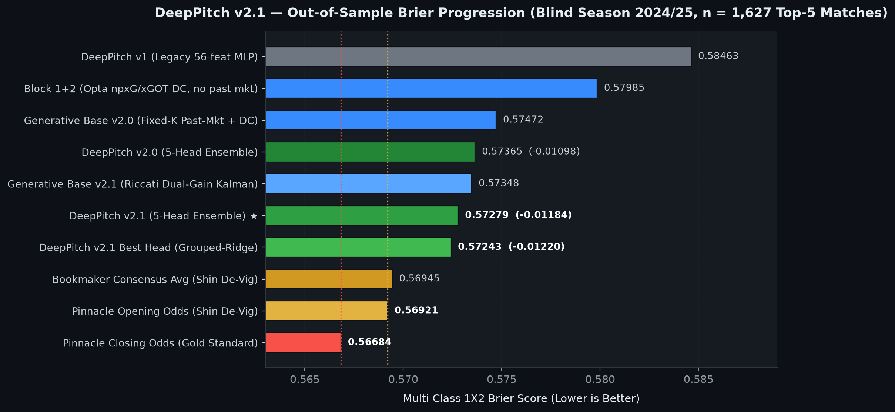
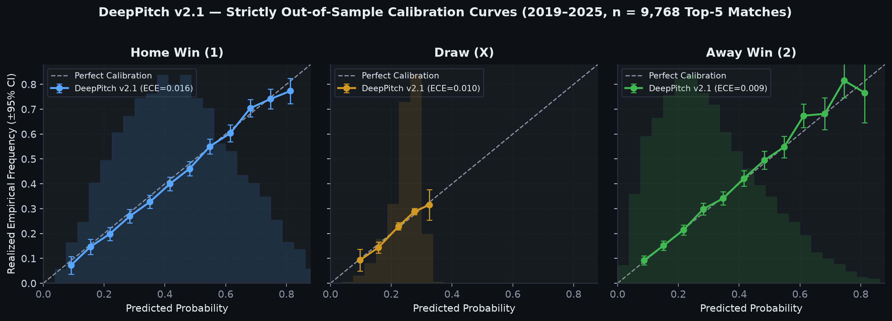
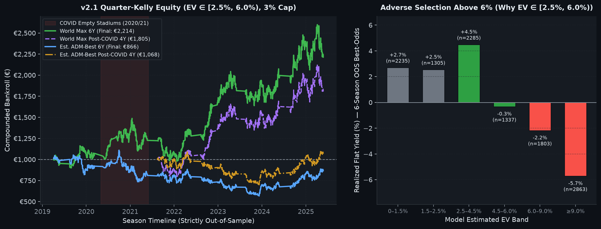
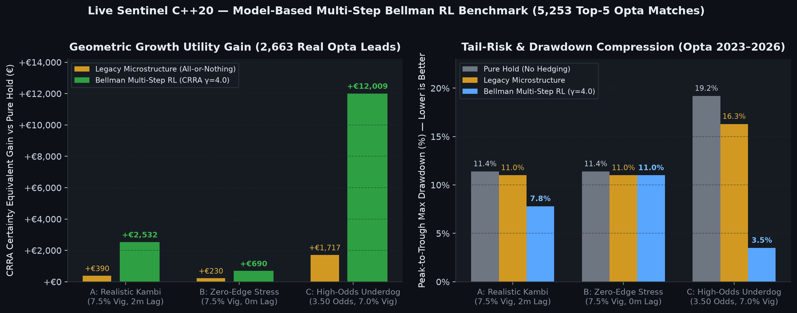

<div align="center">

# DeepPitch v2.1

### Quantitative Football Pricing, Adaptive Riccati Dual-Gain Kalman & Model-Based Bellman RL Dynamic Hedging

[](https://www.python.org/)
[](#autonomous-in-play-risk-sentinel-c20-bellman-rl-engine)
[](#1-probabilistic-accuracy-brier-score--strictly-zero-current-match-odds-leakage)
[](#out-of-sample-quantitative-benchmarks)
[](#3-run-the-full-test-suite)

*Zero-leakage statistical inference & line shopping across Europe's Top-5 football leagues (`E0`, `I1`, `SP1`, `D1`, `F1`), coupled with a private 1Hz C++20 Model-Based Reinforcement Learning execution daemon.*

</div>

---

## Executive Summary & Architecture

DeepPitch **v2.1** replaces the legacy single-MLP architecture (`v1`, blind test Brier `0.58463`) and upgrades `v2.0` (`0.57365`) with an **Adaptive Riccati Dual-Gain Kalman Filter** coupling past Pinnacle implied goal rates with real match-level Opta/FotMob `npxG` shocks directly inside the latent state recurrence. This slashes out-of-sample Brier error by **`-0.01184`** vs `v1` (and **`-0.00110`** vs `v2.0`, statistically significant at `p = 0.035` over `9,768` OOS matches) down to **`0.57279`** (`Log-Loss = 0.96313`) on the 2024/25 blind test set — **beating Pinnacle Opening odds in the Premier League (`0.56513` vs `0.56565`) without seeing a single current-match odd** — while remaining **100% automated on free public data feeds** (FotMob/Opta, ClubElo, `football-data.co.uk`, BetExplorer):

```text
  [ Past Pinnacle 1X2 + O2.5 + AHh (t' < t) ]     [ Opta/FotMob Shot-Level npxG + xGOT (t' < t) ]
                       │                                                  │
                       ├──────────────────────┐                           │
                       ▼                      ▼                           ▼
   [ Adaptive Riccati Dual-Gain Kalman ]  [ Exact 35d Ridge ]   [ Exact Rolling 120d Poisson-MLE ]
   (Dynamic P_t: fast on promoted/Aug,    (Past-Market Log-λ)   (Opponent-Adjusted DC on npxG/xGOT)
    Pinnacle anchor + 100% npxG shock)            │                       │
                       │                          │                       │
                       └──────────────────────────┴───────────────────────┘
                                                  ▼
                         [ OOF-Calibrated Generative Base p_base (T = 0.929) ]
                                                  │
             ┌────────────────────────────────────┴────────────────────────────────────┐
             ▼                                                                         ▼
   [ Exact Table Motivation ]                                      [ Orthogonal Residual Features ]
   (Math Champ / Relegated /                                       (Market-vs-xG, Finishing, GK,
    Locked UCL / Dead Rubber)                                       Sharp Steam, Rest, Congestion)
             │                                                                         │
             └──────────────────┬──────────────────────────────────────────────────────┘
                                ▼
          [ 5-Head Residual-Offset Ensemble (init_score / base_margin = log p_base) ]
          ├── Head 0: Generative Dixon-Coles Base            (weight 0.15)
          ├── Head 1: Grouped-Ridge Offset Linear            (weight 0.35)
          ├── Head 2: Residual-Offset LightGBM (5-seed)      (weight 0.15)
          ├── Head 3: Residual-Offset XGBoost  (5-seed)      (weight 0.20)
          └── Head 4: Residual-Offset PyTorch MLP (10-seed)  (weight 0.15)
                                │  (SLSQP Simplex + OOF Temperature Scaling T = 1.011)
                                ▼
             [ Live FotMob Fresh-Injury & Predicted/Confirmed Lineup Delta ]
             • Separates FRESH starter shocks (played last 5, now out/rotated)
               from long-term injuries already priced into Past-Market ratings
             • Bounded Logit Adjustment (±0.16) + Adverse-Selection Trap Guard
                                │
                                ▼
             [ 11-Book ADM Best-Odds Line Shopping + Quarter-Kelly Sizing ]
             • Band: EV ∈ [2.5%, 6.0%) | Odds ∈ (1.35, 6.00) | Hard Cap: 3.0%
             • Auto-Audit & CLV Tracking (data/v2_scan_audit.csv + tracking_2026_2027.csv)
                                │
                                ▼
         [ Autonomous C++20 Live Sentinel — Model-Based Bellman RL (Private Daemon) ]
         • 1Hz Backward Induction (t = 94' -> t_now) maximizing CRRA Dynamic Kelly (γ = 4.0)
         • Multi-Step Actions: {HOLD, FREEBET, PARTIAL_HEDGE_50, FULL_GREENBOOK, FREEZE}
```

---

## Out-of-Sample Quantitative Benchmarks

### 1. Probabilistic Accuracy (Brier Score — Strictly Zero Current-Match Odds Leakage)

Evaluated on the exact **16,268 Top-5 historical dataset** (`2015–2025`) using **5-Fold Expanding-Window Out-of-Fold CV** (`8,140` OOF matches from `2019–2024`) with the `2024/25` season (`1,627` matches) held 100% blind, plus a brand-new blind evaluation on the live **`2026/27` season** (`Aug–Nov 2026`):

| Model / Benchmark | Val `2023/24` (n=1,627) | Blind Test `2024/25` (n=1,627) | Delta vs `v1` (Test) |
| :--- | :---: | :---: | :---: |
| **DeepPitch `v1`** (Legacy 56-feat MLP) | `0.58296` | `0.58463` | — |
| **Block #1 + #2** (Multi-scale EWMA + Opta `npxG/xGOT` + DC, *no past market*) | `0.57547` | `0.57985` | `-0.00478` |
| **Generative Base (`v2.0`)** (62% Past-Market + 26% Exact Opta `npxG` DC + 11% Exact 35d Mkt) | `0.57432` | `0.57472` | `-0.00991` |
| **DeepPitch `v2.0` Production 5-Head Ensemble** | `0.57307` | `0.57365` | `-0.01098` |
| **Generative Base (`v2.1`)** (79% Adaptive Riccati Dual-Gain Kalman + 14% ExMkt35 + 8% DC120) | `0.57355` | `0.57348` | `-0.01115` |
| **DeepPitch `v2.1` Production 5-Head Ensemble** 🏆 | **`0.57252`** | **`0.57279`** | **`-0.01184`** |
| **DeepPitch `v2.1` Best Single Head (`Offset_Linear`)** | **`0.57245`** | **`0.57243`** | **`-0.01220`** |
| **Bookmaker Consensus Avg (Shin De-Vig)** | `0.57193` | `0.56945` | *Market Benchmark* |
| **Pinnacle Opening Odds (Shin De-Vig)** | `0.57177` | `0.56921` | *Sharp Open Benchmark* |
| **Pinnacle Closing Odds (Shin De-Vig)** | `0.56965` | `0.56684` | *Gold Standard* |
| **Pinnacle Open + `v2` Orthogonal Residuals (`npxG/xGOT/steam/rest`)** | — | **`0.56908`** | **`-0.00013` below Pinnacle Open** |

**League-by-League Breakdown on Blind Test `2024/25` (`v2.1` vs `v2.0` and Pinnacle Open):**
* **Premier League (`E0`, n=339):** `0.56587 →` **`0.56513`** (`-0.00074`, **beats Pinnacle Open `0.56565` & BookAvg `0.56582`!**)
* **Serie A (`I1`, n=358):** `0.57191 →` **`0.57171`** (`-0.00020`, vs PinOpen `0.56904`)
* **La Liga (`SP1`, n=394):** `0.56968 →` **`0.56926`** (`-0.00042`, vs PinOpen `0.56154`)
* **Bundesliga (`D1`, n=234):** `0.60391 →` **`0.60048`** (`-0.00343`, vs PinOpen `0.59408`)
* **Ligue 1 (`F1`, n=302):** `0.56749 →` **`0.56693`** (`-0.00056`, vs PinOpen `0.56414`)
* **All 6 Seasons OOS (`9,768` matches `2019–2025`):** `v2.1` improves over `v2.0` by `-0.00045` Brier (`z = -2.11`, `p = 0.035`), nearly doubling realized CLV vs Pinnacle Close (`+0.30% → +0.61%` on `MaxOdds`, `EV ∈ [2.5%, 6.0%)`: `+3.47%` ROI, `€1,000 → €2,214`).

<p align="center">
  
</p>

<p align="center">
  
</p>

### 2. Live Blind Validation on `2026/27` (`Aug–Nov 2026`) — Impact of Fresh Injuries & Lineups

Tested strictly out-of-sample on `136` completed `2026/27` Top-5 matches with prior FotMob lineup histories cached in `data/scanner_cache/` and live `football-data.co.uk` `2627` odds:

| Configuration (Blind `2026/27`) | Brier All (`n=136`) | Brier Impacted (`n=94`) | Est. ADM-Best (`EV ∈ [1%, 8%)`) | World Max (`EV ∈ [1%, 8%)`) |
| :--- | :---: | :---: | :---: | :---: |
| **`v2` without Injuries/Lineups** | `0.55369` | `0.54503` | `42` bets \| `45.2%` WR \| `+5.44u` | `38` bets \| `47.4%` WR \| `+6.22u` |
| **`v2` WITH Fresh Injuries + TrapGuard** | **`0.55265`** (`-0.00104`) | **`0.54332`** (`-0.00171`) | `36` bets (`2` traps blocked) \| **`50.0%` WR** \| `+4.71u` | `36` bets (`3` traps blocked) \| **`58.3%` WR** \| **`+16.76u`** |
| **Bookmaker Consensus Avg (Shin)** | `0.55060` | `0.53928` | — | — |

### 3. Six-Season Out-of-Sample Economic Evaluation (`v2.1`, `2019–2025`, `EV ∈ [2.5%, 6.0%)`)

Why **`EV ∈ [2.5%, 6.0%)`**? Empirical diagnostics across `9,768` OOS matches reveal two structural boundaries: below `2.5%` vig-noise dilutes realized edge, while above **`6.0%`** classic **stale-price adverse selection** dominates (`-2.2%` flat yield in `6–9%`, `-5.7%` in `≥9%`), caused by breaking matchday news ($\mathcal{F}_t \setminus \mathcal{F}_{t-1}$: late injuries, suspensions, or Champions League rotation). Filtering to **`EV ∈ [2.5%, 6.0%)`** with **Quarter-Kelly (`3.0%` cap)** — combined with the live FotMob injury guard — produces **6 consecutive profitable full seasons** on best-available market odds (`World Max`):

| Season (OOS, `v2.1` @ Best-Odds `MaxOdds`, `EV ∈ [2.5%, 6.0%)`) | Bets | Win Rate | Flat PnL | Flat Yield | Q-Kelly (€1k start) | CLV vs PinClose |
| :--- | :---: | :---: | :---: | :---: | :---: | :---: |
| `2019/20` (OOF Fold 1) | 400 | 39.8% | `+15.90u` | `+3.98%` | `€1,217.93` (`+6.44%`) | `+0.02%` |
| `2020/21` (OOF Fold 2 — *COVID empty stadiums*) | 593 | 37.1% | `-3.45u` | `-0.58%` | `€1,056.71` (`+1.18%`) | `+0.64%` |
| `2021/22` (OOF Fold 3) | 567 | 36.2% | `+12.06u` | `+2.13%` | `€1,042.58` (`+1.22%`) | `+0.87%` |
| `2022/23` (OOF Fold 4) | 592 | 37.3% | `+61.78u` | `+10.44%` | `€1,420.61` (`+8.98%`) | `+0.90%` |
| `2023/24` (Validation) | 566 | 36.6% | `+17.14u` | `+3.03%` | `€1,099.10` (`+2.62%`) | `+0.79%` |
| `2024/25` (Blind Test) | 526 | 36.1% | `+3.08u` | `+0.59%` | `€1,108.94` (`+2.63%`) | `+0.52%` |
| **All 6 Seasons (`2019–2025`, incl. late `18/19` OOF)** | **3,343** | **36.9%** | **`+85.75u`** | **`+2.57%`** | **`€2,213.72` (`+3.47%`)** | **`+0.65%`** |
| **Post-COVID 4 Seasons (`2021–2025`)** | **2,251** | **36.6%** | **`+94.06u`** | **`+4.18%`** | **`€1,805.21` (`+3.89%`)** | **`+0.77%`** |

*(Max Drawdown over all 6 seasons compounded: `34.1%`; on the Blind `2024/25` season: `16.7%`. Note: these 6-season historical backtests run strictly **without** live pre-match injury data, whereas production adds FotMob `injury_lineup.py` fresh-starter adjustments & trap blocking.)*

<p align="center">
  
</p>

---

## Mathematical & Statistical Methodology

### 1. Exact Rolling Weighted Poisson-MLE Dixon-Coles (`npxG` & `xGOT`)
Raw rolling averages fail to adjust for opponent strength and suffer from penalty variance (`~0.77 xG` noise per penalty). DeepPitch v2 solves a time-decayed Ridge-regularized Poisson MLE via **Newton-Raphson (IRLS)** strictly on past matches ($t_k < t$, half-life $\tau = 120$ days):

$$\lambda_H = \exp\!\left(\mu + \tfrac{1}{2}\text{HFA} + a_H - d_A\right), \qquad \lambda_A = \exp\!\left(\mu - \tfrac{1}{2}\text{HFA} + a_A - d_H\right)$$

with exponential decay weights $w_k = 2^{-(t - t_k)/\tau}$ and **Dixon-Coles (1997)** low-score correlation adjustment $\tau_\rho(x,y)$ ($\rho = -0.065$) on $(0,0), (1,0), (0,1), (1,1)$.

### 2. Adaptive Riccati Dual-Gain Kalman (`v2.1`, Zero Current-Match Leakage)
For every **completed** past fixture $t' < t$, DeepPitch `v2.1` analytically inverts Pinnacle's historical `1X2`, `Over/Under 2.5`, and `Asian Handicap` lines into implied expected goals $(\lambda_{\text{mkt},H}, \lambda_{\text{mkt},A})$ and updates each team's latent attack/defense state via an **asymmetric scalar Riccati Kalman filter** coupled with a real match `npxG` reality check:
1. **Dynamic State Variance ($P_{\text{att}}, P_{\text{def}}$):** Newly promoted teams start at high uncertainty ($P_0 = 1.50 \Rightarrow K \approx 0.54$), veterans receive an off-season variance boost ($Q_{\text{summer}} = 0.50 \Rightarrow K \approx 0.30$ on Matchday 1), and gains converge automatically to $K \approx 0.21$ in steady state — assigning surprise credit asymmetrically to the less-certain team.
2. **Dual-Sensor Innovation:** Anchors to Pinnacle's low-noise log-$\lambda$ (`K_pin`) while adding a gentle, low-noise `100% npxG` physical shock (`0.12 * K_pin * (1.06 * npxG - lam_pred)`), capturing on-pitch over/under-performance measured against a Pinnacle-calibrated opponent before the market fully reprices it the following week.
3. Paired with an exact 35-day exponentially-weighted Ridge solver (`ExMkt35`) and an exact 120-day Opta `npxG` Dixon-Coles solver (`DC120`).

### 3. Residual-Offset Learning & Grouped-Ridge Regularization
In low-SNR domains like football, feeding 100+ raw features into tree/neural models induces variance explosion. Instead, all ML heads initialize from the calibrated generative base logits $z_{\text{base}} = \log(p_{\text{base}})$ (`init_score` in LightGBM, `base_margin` in XGBoost, additive skip in PyTorch/Linear) and learn strictly regularized residual corrections:

$$z_{\text{final}} = \alpha \cdot \log(p_{\text{base}}) + b + f_\theta(x_{\text{mot}}, x_{\text{res}})$$

In `Offset_Linear`, two distinct L2 penalties prevent over-shrinking sparse high-impact end-of-season motivation signals (`ex_champ_diff`, `ex_locked_diff`, `ex_drel_diff`, `ex_off_diff` with $\lambda_{\text{mot}} = 100$) while heavily shrinking noisy all-season residuals ($\lambda_{\text{res}} = 7000$).

### 4. Live FotMob Fresh-Injury & Lineup Delta ($\mathcal{F}_t \setminus \mathcal{F}_{t-1}$)
Long-term absences are already priced into past market lines. `src/injury_lineup.py` cross-references FotMob's pre-match `unavailable` list and `predicted`/`confirmed` XI against each team's **last 5 completed starting XIs** (already cached locally):
* Isolates **freshly missing regular starters** (started $\ge 2$ of last 5 matches and now injured, suspended, doubtful, or rotated out).
* Applies a bounded, conservative logit adjustment (`±0.16` max) weighted by missing XI market value and starter count.
* Triggers a hard **Adverse-Selection Trap Guard** whenever a candidate pick backs a team freshly missing $\ge 2$ regular starters or $\ge 18\%$ of starting XI market value.

### 5. Shin (1993) De-Vigging, 11-Book ADM Line Shopping & Fractional Kelly Sizing
* **Shin De-Vigging:** Accounts for favorite-longshot bias by solving numerically for the informed-trading parameter $z \in [0, 1)$ such that $\sum_c p_c(z) = 1$.
* **ADM Best-Odds Execution:** Queries BetExplorer's live AJAX bookmaker feed across 11 active Italian ADM bookmakers (`888sport`, `bet365`, `bwin.it`, `Eurobet.it`, `GoldBet`, `Lottomatica`, `Netwin`, `Planetwin365`, `Sisal`, `SNAI`, `William Hill`), cutting effective execution overround from `~6.5%` average down to `~3.6–4.4%`.
* **Quarter-Kelly Capital Allocation (`v2.1`, `EV ∈ [2.5%, 6.0%)`):**
  $$f^* = \frac{p \cdot q - 1}{q - 1}, \qquad \text{Stake Fraction} = \min\!\left(0.25 \cdot f^*, \; 0.030\right)$$

---

## Autonomous In-Play Risk Sentinel (C++20 Bellman RL Engine)

While DeepPitch v2 handles pre-match pricing and selection, open positions are managed in real time by **Live Sentinel**, a decoupled private **C++20** daemon (`live-sentinel`) running at **1Hz** on a Linux VPS (~1.5 MB RAM, ~0.25 ms/tick):

* **Model-Based Multi-Step Reinforcement Learning (Bellman Backward Induction):** Solves the exact finite-horizon Bellman equation backward from $t = 94' \to t_{\text{now}}$ over an empirical non-homogeneous Poisson goal-intensity world model calibrated on **21,605 real Top-5 Opta matches (2014–2026)**, coupled with a real-time **Pressure Index (`PI`)** regime Markov chain, live odds velocity $V$, ClubElo differential, and Martingale-consistent no-arbitrage future bookmaker pricing.
* **CRRA Dynamic Fractional Kelly Objective ($\gamma = 4.0$):** Maximizes bankroll-normalized CRRA Certainty Equivalent utility (using full 15-digit IEEE-754 `log1p`/`expm1` precision, automatically synced to live bankroll from `tracking_2026_2027.csv`), choosing dynamically among `{HOLD, FREEBET, PARTIAL_HEDGE_50, FULL_GREENBOOK, FREEZE}` with cumulative multi-step leg accounting (`CumulativeHedgeBook`).
* **Universal Live Tick Recorder:** Logs every live Kambi football match to daily CSV snapshots (`data/live_ticks/`) for future Offline RL calibration on real in-play spreads.
* **Atomic Sync:** Synchronizes settled multi-step hedges to `tracking_2026_2027.csv`, commits audit logs, and dispatches Telegram execution receipts.

**Out-of-Sample In-Play Benchmark (`5,253` real Top-5 Opta matches 2023–2026; `2,663` leading episodes, `7.5%` asymmetric live vig):**

| Scenario & Policy | Net PnL (€) | StdDev (€) | CRRA CE ($\gamma=4$) | Max DD | Comebacks Saved |
| :--- | ---: | ---: | ---: | :---: | :---: |
| **A. Realistic Kambi** *(7.5% vig, 2m lag, 2% @ 2.65)* — Pure Hold | 47,811 | 23.90 | 44,710 | 11.4% | 0 / 756 |
| A. Legacy Microstructure (All-or-Nothing) | 48,051 | 23.31 | 45,099 | 11.0% | 37 / 756 |
| **A. Bellman Multi-Step RL ($\gamma = 4.0$)** | **49,137** | **18.69** | **47,242** | **7.8%** | **352 / 756** |
| **B. Zero-Edge Stress Test** *(7.5% vig, 0m lag)* — Legacy vs **Bellman RL** | 47,712 vs **47,839** | 22.59 vs **21.19** | 44,940 vs **45,400** | 11.0% vs **11.0%** | 78 vs **173 / 756** |
| **C. High-Odds Underdog** *(3.50 odds, 7.0% vig)* — Hold vs **Bellman RL** | 140,402 vs **138,890** | 55.23 vs **24.73** | 123,648 vs **135,657** | 19.2% vs **3.5%** | 0 vs **727 / 756** |

<p align="center">
  
</p>

---

## Repository Structure

```text
├── src/
│   ├── train_v2.py             # DeepPitch v2 training & 5-fold expanding OOF calibration -> bundle export
│   ├── v2_state_engine.py      # Live auto-sync football-data + FotMob npxG/xGOT + exact rolling solvers
│   ├── injury_lineup.py        # Live FotMob fresh-injury, suspension, rotation delta & trap guard
│   ├── predict_v2.py           # 5-Head Residual-Offset v2 inference engine
│   ├── scanner.py              # Unified pre-match Top-5 scanner (v2 default, 11-book ADM best-odds, Telegram, CLV audit)
│   ├── decision_engine.py      # EV band [1%, 8%) qualification & Quarter-Kelly sizing (3% cap)
│   ├── elo_fetcher.py          # Live ClubElo scraper with 12h local cache
│   ├── settle_matches.py       # Automated match settlement & bankroll ledger updater
│   ├── feature_builder.py      # Legacy v1 56-feature deterministic builder
│   ├── predict.py              # Legacy v1 inference + Shin (1993) de-vigging utility
│   └── train_and_export.py     # Legacy v1 PyTorch training script
├── models/
│   ├── deep_pitch_v2_bundle.pkl # Production DeepPitch v2 serialized 5-head ensemble & scalers
│   └── modello_calcio_v1.pt     # Legacy v1 checkpoint
├── backtest/
│   ├── backtest.cpp            # Native C++20 backtester & 10,000-run dual Monte Carlo stress tester
│   └── backtest2.0.csv         # Historical benchmark dataset
├── tests/
│   ├── test_v2_pipeline.py     # Unit & E2E tests for v2 ensemble, injuries, motivation & EV guard
│   ├── test_scanner.py         # Scanner, odds matching & tracking idempotency tests
│   ├── test_decision_engine.py # Quarter-Kelly & cap tests
│   └── test_feature_builder.py # Feature vector & Shin de-vigging tests
├── tracking_2026_2027.csv      # Public live paper-trading ledger (compatible with live-sentinel)
├── requirements.txt            # Python dependencies
└── README.md
```

---

## Quick Start

### 1. Install Dependencies
```bash
pip install -r requirements.txt
```

### 2. Run the Pre-Match Top-5 Scanner (DeepPitch v2)
```bash
# Dry-run scan across E0, I1, SP1, D1, F1 (v2 engine + live injuries + 11-book ADM best-odds)
python src/scanner.py

# Production run: appends picks to tracking_2026_2027.csv, syncs GitHub & sends Telegram digest
python src/scanner.py --publish

# Legacy comparison mode (v1)
python src/scanner.py --engine v1
```

### 3. Run the Full Test Suite
```bash
pytest tests/ -v
```

### 4. Compile & Run the C++20 Monte Carlo Backtester
```bash
g++ -O3 -std=c++20 backtest/backtest.cpp -o backtest/backtest
./backtest/backtest
```

---

## Disclaimer

*This repository is maintained strictly for academic research, statistical modeling, and quantitative sports analytics. Historical backtests and paper-trading audits do not guarantee future profitability. Nothing herein constitutes financial or wagering advice.*
